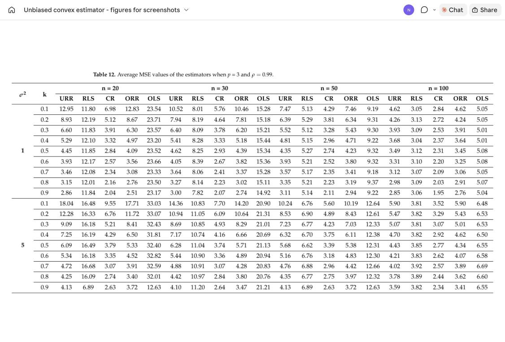
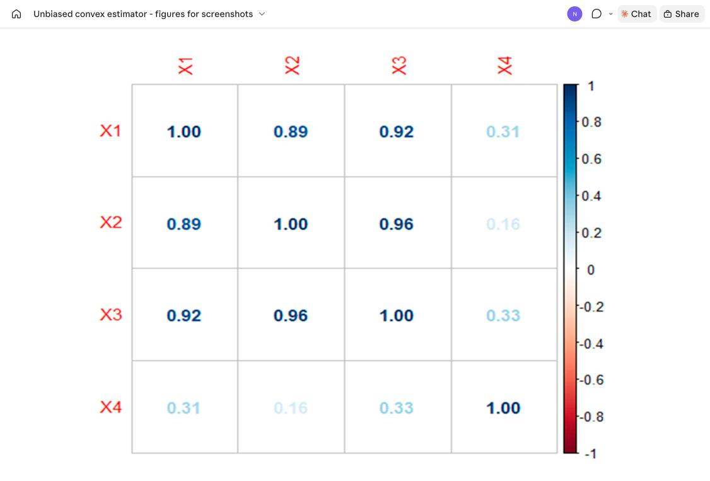
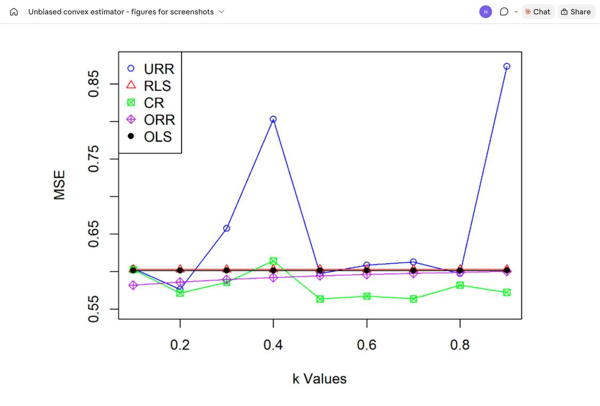
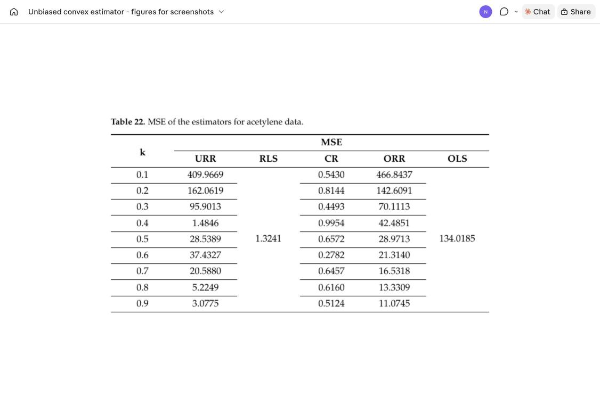

# Unbiased Convex Estimator

**An Unbiased Convex Estimator Depending on Prior Information for the Classical Linear Regression Model**

Mustafa I. Alheety, HM Nayem, B. M. Golam Kibria (2025). *Stats*, 8(1), 16.

[](https://doi.org/10.3390/stats8010016)


The paper is open access and can be read at the DOI link above.

---

## Summary

Multicollinearity inflates the variance of the OLS estimator. Ridge regression (ORR) reduces the variance but is biased, and the unbiased ridge estimator (URR) uses prior information to remove that bias. The restricted least-squares estimator (RLS) uses exact prior restrictions of the form Rβ = r.

This paper combines these ideas into a new **unbiased convex restricted estimator (CR)**: a convex combination of the RLS estimator and a random prior vector J,

$$\hat\beta_{CR} = W\,\hat\beta_{RLS} + (I - W)\,J, \qquad W = (I + kZ^{-1})^{-1},\quad Z = X'X,\quad k \ge 0,$$

with $J \sim N\big(\beta,\ \sigma^2 (I-W)^{-1} W M Z^{-1}\big)$ and $M = I - Z^{-1}R'(RZ^{-1}R')^{-1}R$.

**Main results**

- CR is **unbiased**, and its variance (and MSE matrix) is $\sigma^2 W M Z^{-1}$.
- **Theorem 1:** for $0 \le k \le 1$, CR is better than RLS in the MSE-matrix sense.
- **Theorem 2:** for $0 \le k \le 1$, CR is better than URR in the MSE-matrix sense.
- In the Monte Carlo study and in both real-data examples, CR has the lowest MSE among OLS, ORR, URR, RLS and CR in almost every setting.

## Estimators compared

| Estimator | Formula |
|---|---|
| OLS | $\hat\beta = Z^{-1}X'y$ |
| ORR (Hoerl & Kennard, 1970) | $\hat\beta_{ORR}(k) = (Z + kI)^{-1}X'y$ |
| URR (Crouse et al., 1995) | $\hat\beta_{URR}(k) = (Z + kI)^{-1}(X'y + kJ)$, $J \sim N(\beta, (\sigma^2/k)I)$ |
| RLS | $\hat\beta_{RLS} = \hat\beta + Z^{-1}R'(RZ^{-1}R')^{-1}(r - R\hat\beta)$ |
| **CR (proposed)** | $\hat\beta_{CR} = W\hat\beta_{RLS} + (I - W)J$ |

## Simulation design (Section 4)

| Factor | Levels |
|---|---|
| Predictors p | 3, 5, 10 |
| Correlation ρ | 0.50, 0.70, 0.80 (Tables 1–9) and 0.90, 0.95, 0.99 (Tables 10–18) |
| Sample size n | 20, 30, 50, 100 |
| Error variance σ² | 1, 5 |
| Ridge parameter k | 0.1, 0.2, …, 0.9 |
| Replications N | 10,000 |
| True coefficients | β = (1, …, 1)′ |

Predictors: $x_{ij} = (1-\rho^2)^{1/2} z_{ij} + \rho z_{i,p+1}$ with $z \sim N(0,1)$.

Restrictions (r = 0):

| p | R |
|---|---|
| 3 | [1, 1, 0] |
| 5 | [1, 1, −2, 0, 0] |
| 10 | [1, 1, 0, 0, 1, 0, −2, −1, 1, 0] |

**Table 12** - average MSE, p = 3, ρ = 0.99



## Real-data examples (Section 5)

### Example 1: R&D expenditure (`data/rd_expenditure.csv`)

Total national research and development expenditure as a percentage of GNP, 10 years between 1972 and 1986 (Gruber, 1998; Akdeniz & Erol, 2003).

| Column | Description |
|---|---|
| Year | Year |
| Y | USA |
| X1 | France |
| X2 | West Germany |
| X3 | Japan |
| X4 | Former Soviet Union |

X1, X2 and X3 are highly correlated (Figure 1), and the condition number is about 74.79.

Restrictions: R = [[−1, −2, 1, 0], [−1, 0, −1, 2]], r = (0, 0)′.

**Figure 1** - correlation matrix of the predictors



**Figure 2** - MSE of the estimators across k (Table 20)



CR has the lowest MSE for most k, from 0.5637 (k = 0.5) to 0.6143. RLS and OLS do not depend on k (0.6030 and 0.6015), and URR is unstable (up to 0.8736).

### Example 2: Acetylene (`data/acetylene.csv`)

Conversion of n-heptane to acetylene, 16 runs (Marquardt & Snee, 1975).

| Column | Description |
|---|---|
| Y | Conversion of n-heptane to acetylene (%) |
| X1 | Reactor temperature (°C) |
| X2 | Ratio of H2 to n-heptane (mole ratio) |
| X3 | Contact time (s) |

The condition number is 93.68. Restrictions: R = [[−1, −2, 0], [0, −1, 2]], r = (0, 0)′.

**Table 22** - MSE of the estimators for the acetylene data



CR's MSE ranges from 0.2782 (k = 0.6) to 0.9954, against 1.3241 for RLS and 134.0185 for OLS.

### Extra dataset

`data/portland_cement.csv` holds the Hald / Portland cement data (13 observations; Y = heat evolved, X1–X4 = cement ingredients in %). It is **not used in this paper** and is included as another multicollinear dataset to try the estimators on.

## Repository structure

```
Unbiased-Convex-Estimator/
├── R/
│   ├── simulation_study.R          # Monte Carlo study (Section 4)
│   ├── example1_rd_expenditure.R   # Example 1, R&D expenditure (Section 5.1)
│   └── example2_acetylene.R        # Example 2, acetylene (Section 5.2)
├── data/
│   ├── rd_expenditure.csv          # Table 19
│   ├── acetylene.csv               # Table 21
│   └── portland_cement.csv         # extra dataset, not used in the paper
├── docs/                           # figures and tables from the paper
└── README.md
```

## How to run

```r
install.packages(c("MASS", "Matrix", "writexl", "corrplot"))
source("R/example1_rd_expenditure.R")
source("R/example2_acetylene.R")
source("R/simulation_study.R")   # slow: 216 settings x 10,000 replications
```

Before running:

- The scripts read and write files at paths on the author's computer. Change the `read.csv()` path to `data/rd_expenditure.csv` or `data/acetylene.csv`, and change or remove the `write_xlsx()` path.
- `simulation_study.R` uses ρ = 0.5, 0.7, 0.8 (Tables 1–9). Set `rho_values = c(0.9, 0.95, 0.99)` for Tables 10–18.
- The scripts do not call `set.seed()`, and URR and CR draw a random J, so results change slightly from run to run. Add `set.seed()` at the top for reproducible numbers.
- To test the simulation quickly, lower `num_sim` (for example to 500).

## Citation

```bibtex
@article{alheety2025unbiased,
  title   = {An Unbiased Convex Estimator Depending on Prior Information for the Classical Linear Regression Model},
  author  = {Alheety, Mustafa I. and Nayem, HM and Kibria, B. M. Golam},
  journal = {Stats},
  volume  = {8},
  number  = {1},
  pages   = {16},
  year    = {2025},
  doi     = {10.3390/stats8010016}
}
```

## References

[1] Hoerl, A.E.; Kennard, R.W. Ridge regression: Biased estimation for non-orthogonal problems. Technometrics 1970, 12, 69–82.

[2] Crouse, R.H.; Jin, C.; Hanumara, R.C. Unbiased ridge estimation with prior information and ridge trace. Commun. Stat. Theory Methods 1995, 24, 2341–2354.

[3] Ozkale, M.R.; Kaciranlar, S. Comparisons of the unbiased ridge estimation to the other estimations. Commun. Stat. Theory Methods 2007, 36, 707.

[4] Sarkar, N. A new estimator combining the ridge regression and the restricted least squares method of estimation. Commun. Stat. Theory Methods 1992, 21, 1987–2000.

[5] Månsson, K.; Shukur, G.; Kibria, B.M.G. Performance of some ridge regression estimators for the multinomial logit model. Commun. Stat. Theory Methods 2008, 47, 2795–2804.

[6] Kibria, B.M.G.; Banik, S. Some ridge regression estimators and their performance. J. Mod. Appl. Stat. Methods 2016, 15, 206–238.

[7] Alheety, M.I.; Kibria, B.M.G. Choosing ridge parameters in the linear regression model with AR(1) error: A comparative simulation study. Int. J. Stat. Econ. 2011, 7, 10–26.

[8] Alheety, M.I. New versions of Liu-type estimator in weighted and non-weighted mixed regression model. Baghdad Sci. J. 2020, 17, 361–370.

[9] Kibria, B.M.G. More than hundred (100) estimators for estimating the shrinkage parameter in a linear and generalized linear ridge regression models. J. Econ. Stat. 2022, 2, 233–252.

[10] Özkale, M.R. The relative efficiency of the restricted estimators in linear regression models. J. Appl. Stat. 2014, 41, 998–1027.

[11] Wu, J. An unbiased two-parameter estimator with prior information in linear regression model. Sci. World J. 2014, 2014, 206943.

[12] Özkale, M.R.; Kaciranlar, S. The restricted and unrestricted two-parameter estimators. Commun. Stat. Theory Methods 2007, 36, 2707–2725.

[13] Kibria, B.M.G. Performance of some new ridge regression estimators. Commun. Stat. Simul. Comput. 2003, 32, 419–435.

[14] Alheety, M.I.; Gore, S.D. A new estimator in multiple linear regression model. Model Assist. Stat. Appl. 2008, 3, 187–200.

[15] Nayem, H.M.; Kibria, B.M.G. A simulation study on some confidence intervals for estimating the population mean under asymmetric and symmetric distribution conditions. J. Stat. Appl. Probab. Lett. 2024, 11, 123–144.

[16] Nayem, H.M.; Aziz, S.; Kibria, B.M.G. Comparison among ordinary least squares, ridge, lasso, and elastic net estimators in the presence of outliers: Simulation and application. Int. J. Stat. Sci. 2024, 24, 25–48.

[17] Najarian, S.; Arashi, M.; Kibria, B.G. A simulation study on some restricted ridge regression estimators. Commun. Stat. Simul. Comput. 2012, 42, 871–890.

[18] Akdeniz, F.; Erol, H. Mean squared error matrix comparisons of some biased estimators in linear regression. Commun. Stat. Theory Methods 2003, 32, 2389–2413.

[19] Gruber, M.H.J. Improving Efficiency by Shrinkage; Marcel Dekker: New York, NY, USA, 1998.

[20] Kasubi, F.; Mdimi, O.; Nayem, H.M.; Mwambeleko, E.; Shita, H.; Venkata, S.S.G. Deciphering seasonal weather impacts on crash severity: A machine learning approach. Inst. Transp. Eng. ITE J. 2024, 94, 39–46.

[21] Marquardt, D.W.; Snee, R.D. Ridge regression in practice. Am. Stat. 1975, 29, 3–20.

## Contact

HM Nayem - Department of Mathematics and Statistics, Florida International University (hnayem@fiu.edu)
